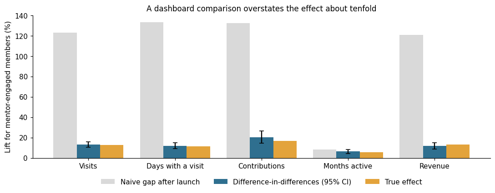
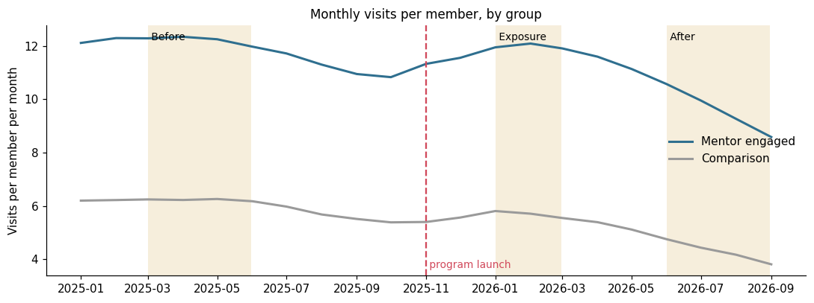
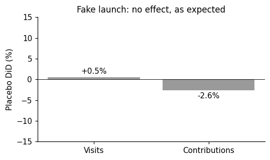

# Did the mentor program work? A difference-in-differences case study

How to measure a program when the people it reaches were never comparable to begin with.

> **Everything in this repository is synthetic.** The community, the program, the members and every number are invented and generated by `data/generate.py`. Because the data is simulated, the true effect is known, so the README can show which method gets it right.



## The business question

A Q&A community launched a paid mentor program in November 2025: a small group of experienced members is paid to answer questions every week. Leadership has to decide whether to keep funding it, expand it or cut it.

The question sounds simple: **do members who engage with mentor answers become more active and stay longer?**

## Why the obvious answer is wrong

The first dashboard compared members who interact with mentor answers to everyone else, after launch. Mentor-engaged members visited **123% more**. Case closed?

No. The same two groups, measured **before the program existed**, already had a **97% gap**. People who end up reading mentor answers are the most active readers to begin with. The dashboard was mostly measuring who they are, not what the program did.

## Approach

| Step | What it does | SQL |
|---|---|---|
| 1. Groups | Frequent interactors only (4+ interactions with answers in Jan and Feb 2026). **Mentor engaged**: 4+ with mentor answers. **Comparison**: 4+ with regular answers and none with mentor answers. Both joined before the "before" window. | `01_groups.sql` |
| 2. Periods | Monthly averages per member for **before** (Mar to May 2025) and **after** (Jun to Aug 2026). Months without visits count as zero. | `02_member_periods.sql` |
| 3. Estimates | Naive gap, baseline gap and the difference-in-differences: how much more the mentor-engaged group changed than the comparison group | `03_estimates.sql` |
| 4. Parallel trends | Monthly visits for both groups across the whole history | `04_monthly_trend.sql` |
| 5. Placebo | The same method with a fake launch in mid-2025 | `05_placebo.sql` |
| 6. Uncertainty | 95% bootstrap intervals, resampling members within each group | `run_analysis.py` |

The estimate is relative, `(after / before for mentor engaged) / (after / before for comparison) - 1`, because the groups start at very different levels. An absolute double difference would mix the program's effect with the size of each group's baseline. Here it is even misleading: both groups lose visits over the period, and since the mentor-engaged group starts twice as high, it loses more visits in absolute terms. The absolute version comes out at **-0.57 visits per month**, as if the program had hurt, while in relative terms the group did 13% better.

## Checking the assumption

Difference-in-differences only works if, without the program, both groups would have moved in parallel. Before launch they sit at very different levels but move together, and both follow the same platform-wide decline afterwards.



The placebo test pretends the program launched in mid-2025, when it did not exist. The method finds close to nothing (+0.5% for visits, -2.6% for contributions), which is what it should find.



## Result

| Metric | Naive gap after launch | Gap before launch | Difference-in-differences (95% CI) | True effect |
|---|---|---|---|---|
| Visits per month | +123% | +97% | **+13.2%** (10.6% to 16.0%) | +12.8% |
| Days with a visit | +134% | +108% | **+12.1%** (9.0% to 15.1%) | +11.6% |
| Contributions | +133% | +93% | **+20.4%** (14.4% to 26.6%) | +16.9% |
| Share of months active | +8% | +2% | **+6.5%** (4.5% to 8.4%) | +5.6% |
| Revenue | +121% | +97% | **+12.1%** (8.7% to 15.1%) | +13.0% |

The true effect comes from the simulated world without the program, for the same members. It falls inside the interval for every metric. The naive comparison overstates the effect about tenfold.

**What to tell leadership:** the program works, but at roughly a tenth of what the dashboard suggested. Members who engage with mentors visit about 13% more and are more likely to stay active. That is the number to weigh against the program's cost.

## Limitations

- **Groups are defined after launch.** Exposure is measured in Jan and Feb 2026, so both groups are, by construction, active in those months (the bump in the trend chart). It affects both groups the same way here, but in real data it is worth checking.
- **Parallel trends is an assumption, not a fact.** If less engaged members tend to drift away faster, the comparison group falls faster and the method overstates the effect. The placebo test and the trend chart are the guard against that.
- **The comparison group is "frequent readers who never interacted with a mentor answer".** If mentor answers crowd out other content for some members, that choice matters and should be discussed with the program team.

## Run it

```bash
pip install -r requirements.txt
python data/generate.py      # synthetic data, about 70 MB in data/raw/
python run_analysis.py       # runs the SQL in DuckDB, adds bootstrap intervals, prints the results
```

`notebook.ipynb` runs the same analysis and draws the charts.

## Stack

SQL (DuckDB), Python (pandas, NumPy, matplotlib). Built with AI assistance (Claude Code); the study design, the checks and the conclusions are mine.
